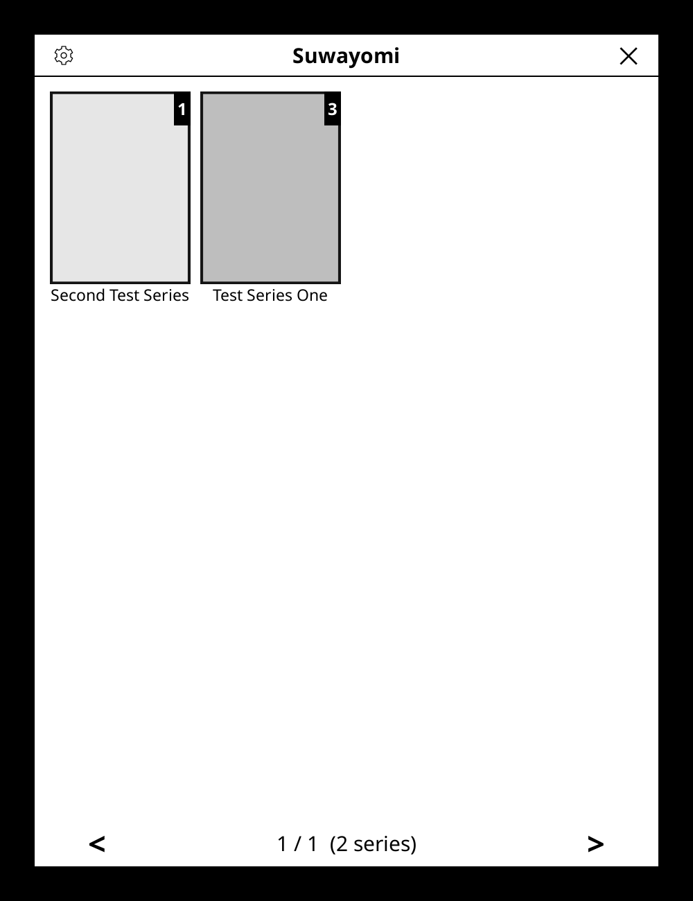
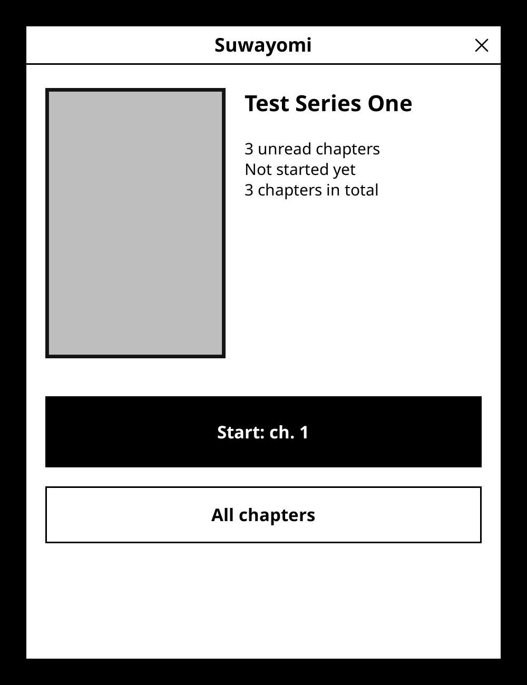
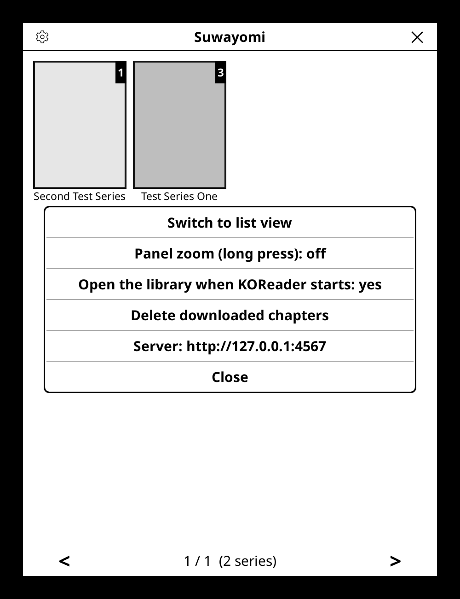

# Suwayomi for KOReader

Read the manga of your own [Suwayomi](https://github.com/Suwayomi/Suwayomi-Server) server directly in
[KOReader](https://koreader.rocks): a cover mosaic of your library, one-tap resume, automatic chaining of
chapters, prefetching of the next ones, and reading progress kept in sync with the server.

| Library | Series | Settings |
| :---: | :---: | :---: |
|  |  |  |

*(Screenshots from the KOReader emulator with a fake server.)*

## Features

- **Library** as a cover mosaic (or a list), with Suwayomi's categories as tabs and a badge with the number of
  unread chapters. Opens by itself when KOReader starts (can be turned off).
- **Series screen** with the cover, your progress and a big *Resume* button that goes straight to the right
  chapter and page.
- **Chapters are downloaded as CBZ files** and opened in KOReader's own reader: all its page-turning, zoom and
  display options apply.
- **Chapter chaining**: turn the page after the last page and the next chapter opens; go back from page 1 and you
  land on the last page of the previous chapter. After the last chapter of a series you are brought back to the
  library.
- **Prefetching**: the next chapters (3 by default) are downloaded in the background while you read, and old ones are
  deleted, so storage stays small. If the e-reader switched its Wi-Fi off, the plugin wakes it up by itself
  to keep the window of chapters filled.
- **Progress sync**: the page reached and the "read" state are sent to Suwayomi. Offline, progress is kept on the
  device and sent as soon as the Wi-Fi is on (while prefetching, or when the library opens).
- **Long press a chapter** to mark it read, unread, or set it as your last read chapter (everything before it
  becomes read, everything after unread).
- **Gesture actions** (Settings > Taps and gestures): library, previous / next chapter, chapter list, resume
  reading. The reader menu also gets *Previous chapter*, *Next chapter* (showing how many chapters are
  ready offline), *Chapter list*, *Back to series* and *Back to library*.
- **Languages**: English and French. Adding another language means copying one small file (see below).
- Optional [VPN add-on](vpn-addon/README.md) to reach your server away from home through WireGuard.

## Requirements

- KOReader. Developed on a PocketBook InkPad X running KOReader v2026.07.2. This public build was verified in the
  KOReader emulator (v2025.10) against a fake server, and with the unit tests in `tests/`. It has not been tried
  on other devices yet. It should work elsewhere, since the code only uses KOReader's own APIs (plus the optional
  PocketBook-specific loopback trick of the VPN add-on): bug reports are welcome.
- A Suwayomi server reachable from the e-reader, using its GraphQL API (developed against v2.4.2366).
- **The chapters must be downloaded on the Suwayomi server.** The plugin asks Suwayomi for the CBZ file of a
  chapter, and Suwayomi refuses chapters it has not downloaded (the plugin then says so). Turn on automatic
  download of new chapters in Suwayomi, or download chapters from its web interface.

Tip: some pages (WebP, GIF) may not display well in KOReader. Suwayomi can convert them to JPEG when it downloads
them (look for "Image download processing" in its settings).

## Installation

1. Copy the `suwayomi.koplugin` folder into KOReader's `plugins` folder on the e-reader
   (e.g. `koreader/plugins/suwayomi.koplugin/`), then restart KOReader.
2. Open the library: it opens automatically at the next launch, or use the main menu > *Suwayomi*.
3. The first time, the plugin asks for the **address of your Suwayomi server**, for example
   `http://192.168.1.10:4567`. It can be changed later in the library's gear menu.

Chapters are stored in `/mnt/ext1/Manga/_Suwayomi` on PocketBook devices, and in
`<KOReader folder>/suwayomi_downloads` elsewhere (see `download_dir` below).

## Using it

- **Tap a cover** to open the series, then *Resume* (or *Start*). *All chapters* lists them with their state.
- In the mosaic, swipe or tap the footer's left / right half to change page. The gear opens the settings; the
  cross closes the library.
- While reading, the usual KOReader gestures apply. Page-turn past either end of a chapter to chain.

## Settings

The gear menu of the library has: mosaic / list view, panel zoom on long press (off by default, so that a long
press does not start KOReader's panel zoom or text selection), open the library at startup, delete the downloaded
chapters, and the server address.

A few more settings are plain values in `settings/suwayomi.lua` (inside KOReader's folder, edit it while KOReader
is closed):

| Key | Default | Meaning |
| --- | --- | --- |
| `server_url` | none | Address of the Suwayomi server |
| `view` | `"mosaic"` | `"mosaic"` or `"list"` |
| `autostart` | `true` | Open the library when KOReader starts |
| `chain` | `true` | `false` turns chapter chaining off |
| `prefetch_ahead` | `3` | Number of following chapters kept on the device (1 to 10) |
| `download_dir` | see above | Folder where chapters are stored ("Delete downloaded chapters" only acts on folders named `_Suwayomi` or `suwayomi_downloads`) |
| `panel_zoom` | `false` | KOReader's panel zoom on long press |

## Translating

Texts are written in English in the code. For another language, copy `suwayomi.koplugin/suwayomi_lang_fr.lua` to
`suwayomi_lang_<code>.lua` (the two-letter code of KOReader's language, e.g. `de`) and translate the values on the
right (keep the `%s` / `%d` markers). KOReader has no per-plugin translation catalogue, which is why the plugin
brings its own small mechanism (`suwayomi_i18n.lua`).

## Tests

The prefetching, the VPN route choice and the translations have tests that run with KOReader's LuaJIT, without a
device or a server. See [tests/README.md](tests/README.md).

## Disclaimer

An independent project, not affiliated with or endorsed by Suwayomi, Mihon / Tachiyomi, KOReader or PocketBook.
The plugin does not provide, host or index any content: it only talks to the Suwayomi server that you run. You are
responsible for what you read with it and for respecting the rights of the works and the terms of the sources you
use.

## License and credits

Copyright (C) 2026 sas-web. Distributed under the **GNU Affero General Public License v3.0** ([LICENSE](LICENSE)),
the same license as KOReader.

`suwayomi.koplugin/suwayomi_reader.lua` is adapted from `MangaReader.lua` of
[Rakuyomi](https://github.com/hanatsumi/rakuyomi) (AGPL-3.0), a KOReader plugin for reading manga from online
sources. Thanks to its authors: the way of hooking into KOReader's reader and of leaving it cleanly comes from
their work.
